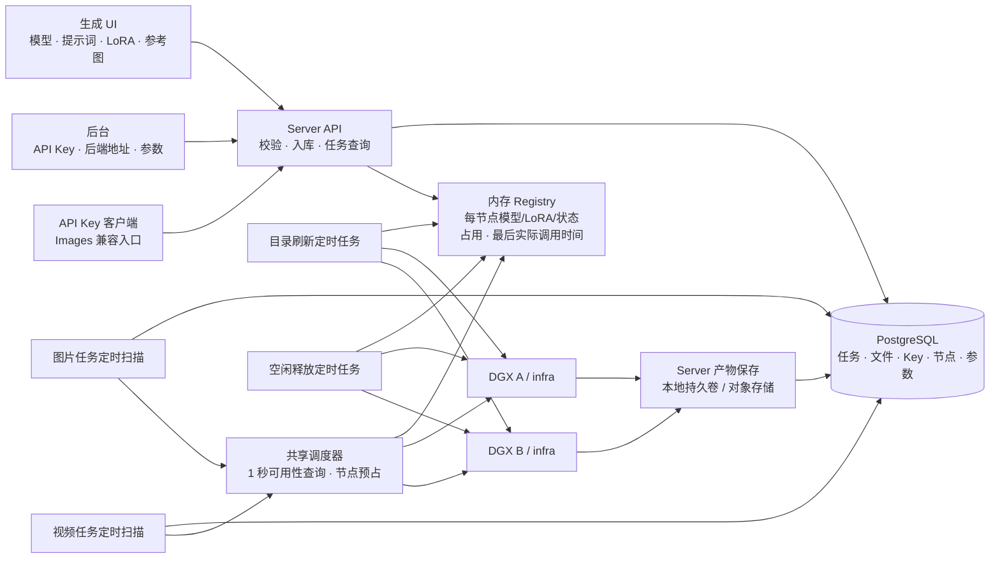
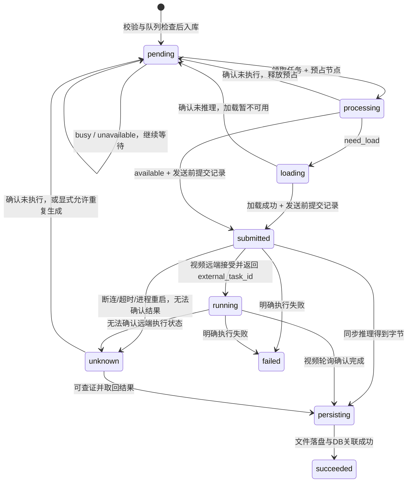
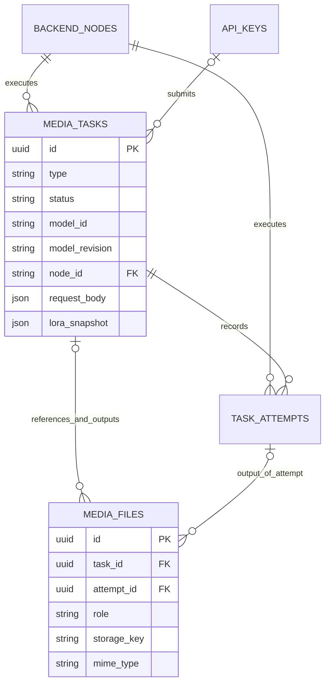

# 两台 DGX：UI 与 Server 设计

日期：2026-10-12。交付范围：界面原型、系统结构、数据表草案、模型 JSON 和接口约定；不是已接通 DGX 的生产实现。本方案覆盖之前方案的模型目录管理决策。

## 1. 已确定的边界

- 两台 DGX，infra 只提供资源发现、能力与状态查询、加载、释放和推理。
- 模型和 LoRA 全部由 infra 本地目录发现，server 定时实时聚合到内存。不建 models、loras、model_configs 表，不要求人工登记统一目录。
- 节点地址及凭证、API Key、系统参数、图片/视频任务、参考文件和生成产物需要持久化。模型配置快照写进任务，是历史证据，不是目录表。
- 图片和视频使用一张 media_tasks 表，以 type 区分；没有 workspace、agent_session 或资源目录树。
- 初期 server 一个进程、一个共享内存 Registry、一个调度器；HTTP 异步接入与后台执行协程共享状态。不部署多个独立 API worker，否则内存缓存和节点占用不能协调。无需 Redis/Celery。
- UI 只做可用模型切换、提示词、LoRA、按能力显示的参考文件输入、提交与结果；类型来自模型，不额外要求用户先选图片/视频。

## 2. 界面

生成页：模型下拉（类型和中文状态）→ 提示词 → 可选一个 LoRA → 参考文件（支持才显示，动态 MIME/数量限制）→ 生成。模型切换清空 LoRA；已有参考文件不符合新模型时提示重新选择并阻止提交，不能悄悄丢弃。默认尺寸和采样参数来自模型 JSON；首期不展示高级参数。

提交后显示任务状态、等待原因、结果图/视频和下载入口。busy/need_load 可以提交排队；unavailable 不能新提交。队列满时按钮禁用，但是否接收仍以 server 的原子检查为准。

后台只有：

| 页面 | 内容与操作 |
|---|---|
| API Key | 名称、前缀、启用状态、最后调用时间；创建、停用、撤销；完整 Key 仅创建时展示一次 |
| 模型后端 | 节点 ID、地址、启用、最近同步、错误；新增/编辑地址和服务凭证、接入并同步、禁用；展开只读模型/LoRA/JSON能力 |
| 系统参数 | maxCount、目录刷新周期、节点过期时间、模型空闲释放时间（默认 3600 秒）；查询超时固定 1 秒 |

后台不编辑聚合的模型/LoRA；修改 infra 模型目录中的配置，下次同步生效。API Key 页面不能读取节点管理凭证。

## 3. 系统结构



server 建议沿用 FDE 的 FastAPI、SQLAlchemy AsyncSession、PostgreSQL、APScheduler 结构：

```text
server/src/
  main.py                  # API 与唯一 scheduler/registry 的生命周期
  controllers/             # generation、tasks、uploads、models、admin、images compatibility
  schemas/                 # 入参、任务结果、节点目录和配置验证
  models/                  # media_task、task_attempt、media_file、backend_node、api_key、setting
  services/                # task、artifact、key、backend、admission
  cluster/                 # registry、availability、node_client、dispatch
  scheduler/               # catalog_sync、image_scheduler、video_scheduler、model_release、recovery
```

## 4. 参考 FDE 的依据与修正

已查看 `D:/project/FDE/api/src/models/media_task.py`、`services/media_task_service.py`、`scheduler/image_scheduler.py`、`scheduler/video_scheduler.py`、`scheduler/common.py` 和 `models/resource.py`。

沿用 type/status/request_body/raw_result/attempt_count、短事务→网络调用→短事务、图片同步推理和视频可选远端任务轮询。去掉 workspace_id、agent_session_id、model_config_id，使用 model_id/revision、node_id 和独立 media_files。

FDE 的 claim_pending/claim_submitted 先 UPDATE 全部匹配行，再对返回 ID 切片。新设计必须在 UPDATE 前 LIMIT，并使用行锁/SKIP LOCKED。不能复制这个领取缺陷。FDE 的未知结果回收也不能直接套用到同步 GPU 推理：submitted 超时不能证明尚未执行。

## 5. infra 模型目录与 JSON

```text
MODEL_ROOT/
  qwen-image-2.1/
    model-config.json       # 类型、参考能力、默认值、限制、制品版本
    model/                  # Diffusers 权重目录
    loras/
      style-v1.safetensors
      style-v1.json         # 可选显示名/版本/预期基础版本；文件发现仍为事实来源
  some-video-model/
    model-config.json
    model/
    loras/
```

详见同目录 `model-config.schema.json`、`model-config.image.example.json`、`model-config.video.example.json`。视频样例和原型里的参考模型是设计占位，不证明 backend 已实现。

规则：目录名=model_id；LoRA 文件名=lora_id（在 model_id 内唯一）。revision 使用部署制品的不可变版本，artifact_sha256 来自内容哈希 manifest；不能使用各机器的 mtime 指纹当跨节点版本。JSON 不接受用户传入绝对路径。

infra 对 JSON 做结构验证，读取已实现 backend 的能力后取交集：JSON 声明支持参考，不意味着 backend 自动支持参考。JSON 与实际实现矛盾时标记不可用并返回原因；没有 JSON 或 JSON 错误也不能对用户发布。LoRA 目录发现不等于兼容，只有加载验证通过/已验收的 LoRA 组合才进入可提交集合。

结构 schema 之外，还要做语义校验：min_count <= max_count、尺寸上下限有序、默认尺寸在范围内并满足倍数/像素上限、default_steps <= steps_max、视频默认时长不超过最大值。示例 artifact_sha256 全零是占位，真实部署必须替换为 manifest 摘要，infra 拒绝占位摘要。

同 model_id/revision/LoRA 制品版本的节点可以聚合；同名不同版本在 UI 中显示版本后缀。相同版本但权重摘要不同为冲突，禁用冲突路由并在后台展示原因。参考能力、参数限制保留到每个节点，不能简单取并集后派发到不满足条件的节点。

LoRA 可选 JSON 字段为 `lora_id`、`display_name`、`revision`、`base_model_revision`、`sha256`，样例见 `lora-config.example.json`；有效兼容状态由 infra 验证结果提供，不能在 JSON 中自称已验证。没有 sidecar 时以文件名作 ID/展示名、内容 SHA256 作版本；只有实际校验成功才可提交。

建议新增只读 `GET /internal/v1/catalog`，一次返回一致的模型/LoRA/配置快照，避免多个接口间版本错位：`catalog_revision`、`models[]`（identity、configuration、effective_capabilities、local_available）、`loras[]`（model_id、identity、compatibility）、`runtime`（loaded model、busy、state）。目录快照不执行推理。短探测可以继续使用内部模型状态接口，但必须核对同版本。现有接口不改为用户可传任意路径的下载或注册接口。

## 6. 内存聚合与短查询

建议默认 catalogRefreshSeconds=5、nodeStaleSeconds=15。地址保存即立即同步；之后并行同步两台节点。单节点快照包含 node_id、catalog_revision、observed_at、模型 JSON、LoRA、运行状态和执行槽。新快照验证完成后整体替换，避免半更新目录。失败保留上一份快照至 TTL；过期或后台禁用后立即退出可调度集合。UI 可能看到最多约 15 秒的下线延迟，这是接受的行为。

对外目录由有效节点快照实时计算；最后一个节点过期后该模型从新任务列表移除。已经入库的任务仍保存请求/能力快照，并继续等待同版本节点恢复。重启从持久化节点地址重建 Registry；同步完成前不接收新生成任务，返回 503 registry_initializing。

```http
GET /api/cluster/availability?model_id=qwen-image-2.1&lora_id=style-v1
```

model_id + lora_id 是最小查询键；任务执行还必须携带已固定 revision、LoRA revision 和实际参考/尺寸需求。省略 lora_id 表示基础模型，不拼接成有歧义的字符串。

```json
{
  "status": "available",
  "node_id": "dgx-a",
  "model_id": "qwen-image-2.1",
  "revision": "r1",
  "reason": "loaded_and_idle",
  "checked_at": "2026-10-11T08:00:00Z"
}
```

| 状态 | 精确定义 | 调度动作 |
|---|---|---|
| available | 至少一个符合模型/LoRA/能力约束的节点，已就绪且空闲 | 预占该节点，提交推理 |
| need_load | 符合约束的节点有权重，执行槽空闲且模型槽为空，可以加载 | 预占节点，显式加载；成功后推理 |
| busy | 有符合约束的节点，但执行中/加载中/释放中/已预占，或模型槽被另一个尚不能释放的模型占据 | 保持 pending 等待 |
| unavailable | 无符合约束的有效节点、版本冲突、LoRA不兼容，或探测超时 | 保持已存在的任务 pending 等待；拒绝新任务 |

优先级 available > need_load > busy > unavailable。两台节点实时状态探测并行，包含连接/读取在内的整个查询绝对截止时间为 1 秒，不是每节点串行 1 秒。成功的另一台仍可参与；超时节点不参与这次派发，不能用过期状态强行执行。目录缓存 TTL 与本次查询的 deadline 是两个不同概念。返回值只是观察，不是锁；选择之后 server 原子预占，infra 再原子检查实际状态。

## 7. 任务、队列和调度

使用 AsyncSession 异步写数据库，必须提交成功才向 UI 返回 task_id；不使用不可靠的 fire-and-forget 入库。参考文件先持久化再建立任务关联，失败或满队列留下的无主上传由清理任务回收。

maxCount 定义为图片+视频共同的等待容量，计数 pending、processing、loading；submitted/running/persisting 不占等待位，但受节点执行槽限制。通过锁定 system_settings 的 singleton 行，在同一短事务内检查 count、插入任务。count >= maxCount 拒绝本次提交（429 queue_full），所以不会因为并发而越界。设置值降低到当前积压以下时保留已有任务，只停止新提交；UI 显示此情况。

调度扫描图片/视频各类 pending，每 2 秒建议批量 20；公平轮流调度，检查多个候选，不能让一个不可用模型阻塞另一类可执行任务。轮询 availability 的 busy/need_load/unavailable 不增加 attempt_count。没有合适节点的任务一直等待，不因等待时长而失败。



首期 infra 图片/视频都可同步执行，视频用独立长推理超时，不能把 1 秒查询超时用于加载/生成。若视频 backend 提供异步任务，VideoScheduler 才使用 external_task_id 轮询；其远端任务记录仅用于推理运行，不承载业务历史。

| 定时任务 | 建议周期 | 作用 |
|---|---|---|
| catalog_sync | 5 秒，可配置 | 并行同步两节点目录与配置，原子替换内存快照 |
| image_dispatch / video_dispatch | 2 秒 | 扫描各类待处理任务，交给共享节点调度器 |
| video_poll（仅异步 backend） | 3 秒 | 查询已有 external_task_id，不重新创建推理 |
| model_release | 60 秒 | 满 1 小时空闲后使用唯一卸载接口 |
| task_recovery | 30 秒 | 回收尚未发送的领取租约，隔离未知执行 |

每项 max_instances=1、coalesce=true。调度扫描启动受限后台协程后即返回，长推理不占用整个定时 job；节点预占持续到生成/清理完成。图片和视频共享节点锁，不分别独立计算可用槽。

task.node_id 记录本次/最终执行节点；task_attempts 保留所有尝试的节点。发送网络请求前，在短事务中记录 attempt_id、node_id、固定模型/LoRA版本和 submitted_at。实际发送才递增 attempt_count。执行在后台协程中进行，不阻塞后续调度扫描、目录刷新或健康检查；不在整个推理期间持有数据库连接。

pending/processing/loading 尚未发送的租约失效可恢复；submitted/running 进入 unknown，不能立即重复提交。查证不到时保留未知状态与节点隔离原因，后台可处理，不能自动释放正在执行或执行状态不明的节点。API 连接断开不取消已入库任务。

## 8. 定时释放：只有一个释放入口

infra 保留现有 `POST /internal/v1/models/{model_id}/unload` 作为唯一释放接口，不另建 release/evict/clear-cache。加载接口仍然需要，但不是释放入口；生成不得隐式切换模型。

server 内存保存 `(model_id, revision)` 的集群 last_invoked_at（单调时钟）、每个节点执行状态与最后活动时间。实际向任意节点派发该模型时更新时间；释放条件要求距最近调用和最近执行结束均已满系统参数 `idle_release_seconds`（默认 3600 秒，管理后台可改）的时间。目录查询、UI 切换、队列扫描、busy 重试不刷新时间。因此集群内这个模型在空闲阈值内持续被调用时，不释放任何该版本副本。管理员可通过 `POST /api/admin/nodes/{node_id}/models/{model_id}/load|unload` 手动预热或释放模型，手动加载同样进入空闲计时。

每 60 秒扫描：空闲 >= 1h、无推理/加载/未知结果、无正在领取或等待加载的该版本任务，才逐节点释放。等待该模型的合法 pending 任务可保护其现有常驻副本；unavailable 的空转轮询不刷新调用时间。释放和派发使用同一节点互斥/预占机制，操作前重查时间；先标记 releasing 再调用唯一卸载接口，成功才标记 unloaded，失败重新同步。

其他模型占槽且未满足释放条件时，本任务返回 busy 等待，不能绕过定时释放策略做 LRU 强制切换。server 重启后 loaded 模型给予新的 1h 保守保护期，避免内存时间丢失即立刻卸载。

## 9. 数据设计和内容持久化

可执行的 PostgreSQL 草案见 `server-schema.sql`（需未来接入迁移后才算实现）。

| 表 | 用途 |
|---|---|
| backend_nodes | 稳定 node_id、名称、地址、启用、加密服务凭证；不保存目录/运行快照 |
| api_keys | 名称、前缀、Key 哈希、状态、使用时间；只创建时返回明文 |
| system_settings | singleton、maxCount、刷新周期、TTL；也作为提交容量检查的事务锁 |
| media_tasks | type/status、model_id/revision、LoRA/能力/请求快照、node_id、等待原因、结果和时间 |
| task_attempts | 每次真正提交的 attempt_id/node_id、时间、结果或未知原因 |
| media_files | 输入/输出、storage_key、MIME、字节数、hash、宽高/时长、顺序与角色 |

media_tasks.model_id/revision 和 LoRA snapshot 没有模型目录外键。节点记录保留稳定身份，禁用不抹去任务历史。API Key 撤销不删除任务。



保存路径示例：`inputs/{upload_id}/reference-0.png`，`outputs/{task_id}/{attempt_id}/0.png` 或 `0.mp4`。storage_key 存相对持久卷路径/对象存储 key，不能只存容易过期的下载 URL。server 负责解码图片/下载视频、校验 MIME/hash、写临时文件、原子重命名，再短事务写 media_files 并标记任务成功。对象存储以完整对象上传成功为落盘边界。

若保存文件成功但 DB 失败，按 task_id/attempt_id 路径和完成 manifest 重试关联，不能再次推理；未关联的临时文件另行清理。raw_result 只存元数据，不把大段 Base64 写入数据库。下载走有权限的 `/api/files/{id}/content`，输出存储位于 server 持久卷，infra 不管理用户产物。

## 10. 业务 API 与 Images 兼容入口

| 入口 | 约定 |
|---|---|
| GET /api/models | 聚合有效模型、版本、类型、LoRA、参考能力和中文状态 |
| POST /api/uploads | 持久化参考文件，返回 upload_id；提交时重新验证归属/MIME/数量 |
| POST /api/tasks | 图片/视频通用异步提交，DB提交后返回 202 + task_id |
| GET /api/tasks/{id} | status、wait_reason、node_id、输出文件与错误 |
| GET /api/cluster/availability | model_id + 可选 lora_id，整体 1 秒截止 |
| /api/admin/keys | Key 创建、停用、撤销 |
| /api/admin/backends | 节点配置、接入同步、禁用、只读聚合详情 |
| /api/admin/settings | 修改 maxCount/刷新周期/TTL |
| GET /v1/models | OpenAI 风格模型列表；详细能力使用 /api/models |
| POST /v1/images/generations | Bearer Key，JSON 文生图 |
| POST /v1/images/edits | Bearer Key，multipart，image/image[] 参考图 |

官方 Images 接口支持 generations 与 edits；编辑使用参考文件，GPT Image 默认返回 b64_json。按官方 GPT-Image-2 请求/响应形状设计兼容子集，不能把本地 Qwen 冒充 OpenAI 模型。调用者 model 填聚合目录中的实际 model_id；如果需要 gpt-image-2 别名，必须显式配置并声明它指向本地模型。参考：[生成](https://developers.openai.com/api/reference/resources/images/methods/generate)、[编辑](https://developers.openai.com/api/reference/resources/images/methods/edit)、[GPT-Image-2](https://developers.openai.com/api/docs/models/gpt-image-2)。

默认兼容模式：同样先入库，由定时调度执行；HTTP 等待保存成功后返回 200 `{"created":1791734400,"data":[{"b64_json":"..."}]}`，以 X-Task-ID 关联任务。不能默认返回 202 并声称普通 Images SDK 完全兼容。HTTP等待有单独 deadline；超时返回 504 与 task_id/X-Task-ID，持久化任务继续等待/执行，可通过任务接口查询。

可选扩展 `Prefer: respond-async` 返回 202 + task_id + Location，由客户端轮询；UI 默认直接使用异步入口。扩展不是 OpenAI 标准承诺。API Key 对任务查询/文件下载也需要权限校验。

支持子集先固定 n=1、prompt、model、size（含 auto 映射到模型默认值）、output_format=png。quality=auto 使用模型默认，其他值仅能力声明支持时接受。LoRA/seed/steps 使用显式扩展字段，Python SDK 可通过 extra_body 传递；edits 的 LoRA 可用 JSON 字符串 multipart 字段。其他参数、stream/mask/background 等尚未实现的能力明确报 400，不静默忽略。尺寸使用目标模型限制，不套用 GPT-Image-2 尺寸限制到 SDXL。input_fidelity 对 GPT-Image-2 官方文档要求省略。

文生图示例（本地兼容平台，不是直接请求 OpenAI）：

```python
from openai import OpenAI
client = OpenAI(api_key="YOUR_PLATFORM_KEY", base_url="http://localhost:8000/v1")
result = client.images.generate(
    model="qwen-image-2.1", prompt="雨夜城市，电影感", size="1024x1024", n=1,
    extra_body={"loras": [{"lora_id": "style-v1", "scale": 0.8}]},
)
```

参考图：`client.images.edit(model="实际支持参考的模型ID", image=[open("ref.png","rb")], prompt="保留主体，改成水彩风格")`。只有 effective capabilities 支持参考才能接收；当前仓库 Qwen-Image-2.1 backend 仅文生图，不能因为加 JSON 就启用 edits。

## 11. 当前实现与新设计的差距

后续实现已加入 server/、ui/ 和整套 Compose 部署：内存目录、异步数据库任务、共享节点调度、Key与后端管理、图片/参考图/视频协议处理、产物保存及恢复。infra 已增加 model-config.json 校验、制品manifest、catalog和执行前版本校验。当前DGX的SDXL/Qwen backend仍只提供文生图；参考图/视频由实现相应协议的其他节点提供。实际部署和测试边界以根目录 README.md 与部署验收报告为准。

## 12. 后续实现验收条件

- 两节点重复模型按相同版本聚合，冲突摘要不会混用；LoRA 与对应节点绑定。
- 节点断线在TTL后从目录移除；1秒查询即使一台挂起仍能使用另一台。
- 图片/视频并发提交不能突破 maxCount；无节点的已有任务持续 pending。
- 双调度器不会重复领取或同时占用同一个 GPU 槽；领取先 LIMIT。
- need_load 显式加载，busy 不自动卸载其他模型；生成不切模型。
- 59分钟空闲不释放，满1小时且无活动才释放；实际调用刷新，轮询不刷新。
- task 记录执行 node_id 和每次尝试；重启后 submitted 不盲目重新生成。
- 参考文件类型/数量依模型验证；当前未实现能力不能被JSON伪造。
- 图片/视频落盘并关联任务，DB失败只重试关联；成功响应前有持久化产物。
- Images 默认200+b64_json；异步扩展才202；Key隔离、撤销和下载权限生效。

## 13. 本次设计交付核对

下列核对只证明设计与原型覆盖需求，不代表生产服务通过上述运行验收。

| 用户要求 | 设计证据 |
|---|---|
| 两台 DGX、实时内存聚合、接受下线延迟 | 第1/3/6节，内存Registry、5秒刷新、15秒过期 |
| 最简模型切换、提示词、LoRA、参考图 | 第2节及交互生成页；已检查切换与参考数量校验 |
| 后台 API Key、模型后端接入、同步、系统参数 | 第2/10节及三个后台页面；已检查Key撤销、节点禁用/新增和maxCount |
| 模型目录旁JSON、图片/视频、参考类型与最大数量 | 第5节，JSON Schema、图片/视频/LoRA样例；两份模型样例通过schema及语义范围校验 |
| FDE任务结构、没有workspace、异步入库、定时处理 | 第4/7/9节，SQL中的media_tasks按type分类，没有模型目录表和workspace字段 |
| node_id、model_id+lora_id查询、四状态、1秒超时 | 第6/7节，状态定义、整体截止时间和节点预占；原型展示执行节点 |
| 无可用集群一直等待、maxCount拒绝新提交 | 第7节，等待状态自循环、全局容量事务；原型队列上限检查通过 |
| 1小时活跃不释放、内存状态、唯一释放接口 | 第8节，实际调用/结束时间、释放互斥、唯一unload路径 |
| server持久化内容、任务关联保存位置 | 第9节，media_files、task_attempts关系与保存顺序；原型显示PNG/MP4路径 |
| API Key调用参考gpt-image-2接口 | 第10节，官方来源、generations/edits、默认200与异步202扩展区别 |

本节保留初次设计交付的验证记录：模型配置JSON Schema有效；图片与视频样例通过字段和范围检查；PostgreSQL草案12条语句通过pglast解析（未应用到数据库）；界面在1100/736/390/320像素宽度下无外层横向溢出，深色模式已视觉检查，浏览器无运行错误。后续代码实现、实际UI/API测试及DGX部署状态见根目录 DEPLOYMENT.md；真实GPU生成不包含在本次非GPU验收中。
